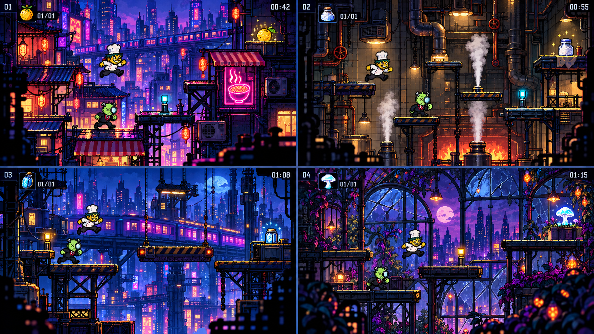
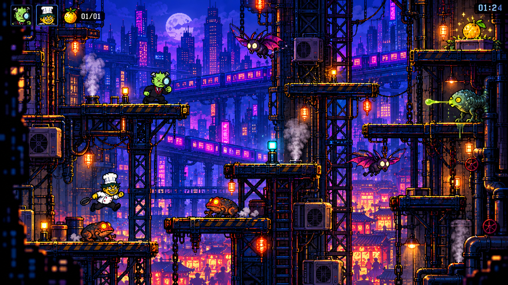
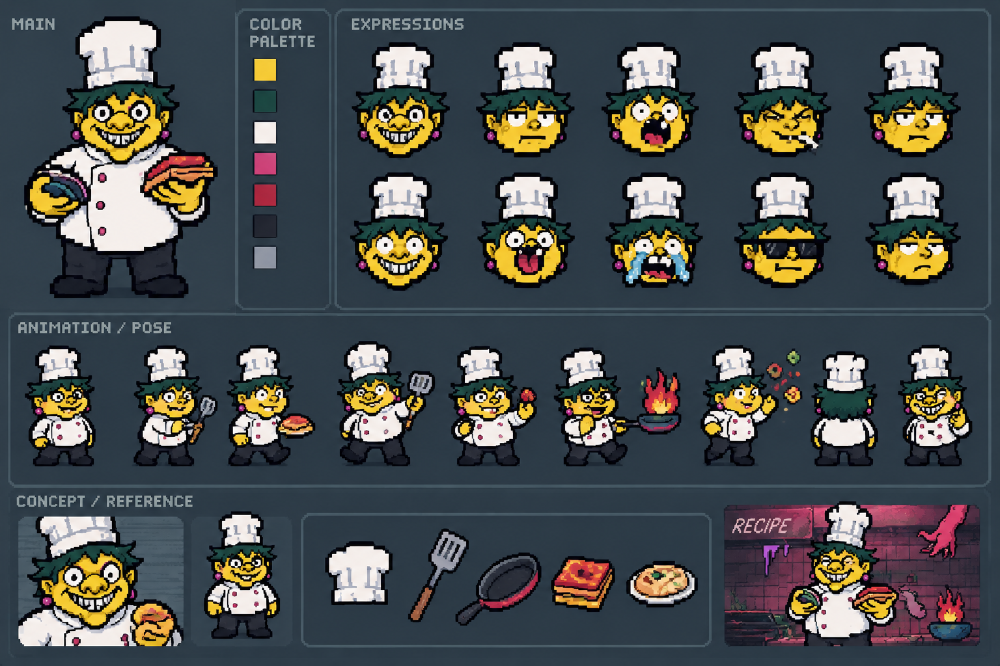
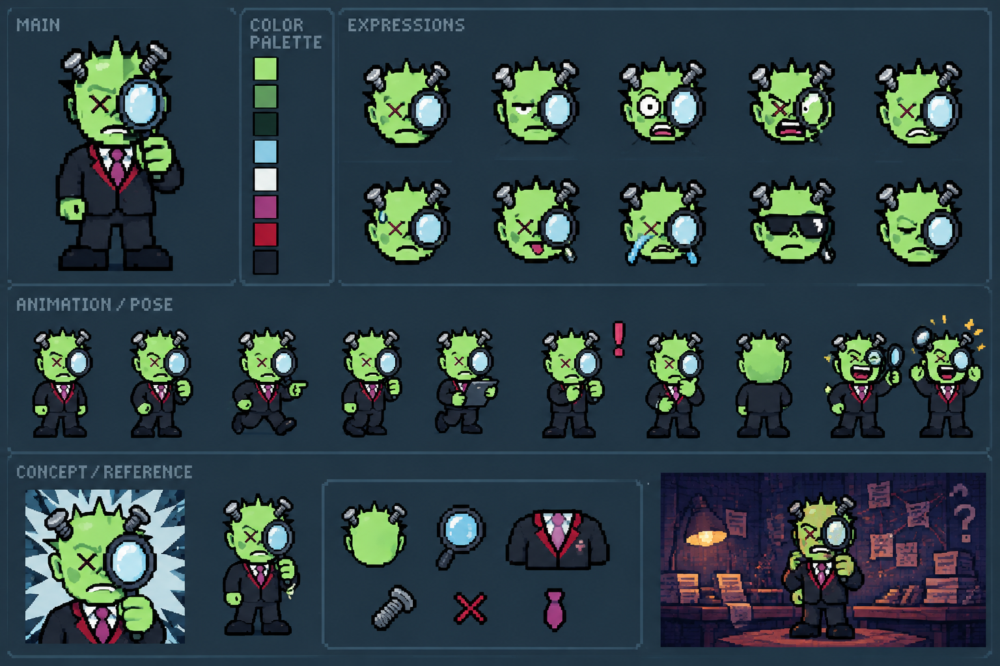
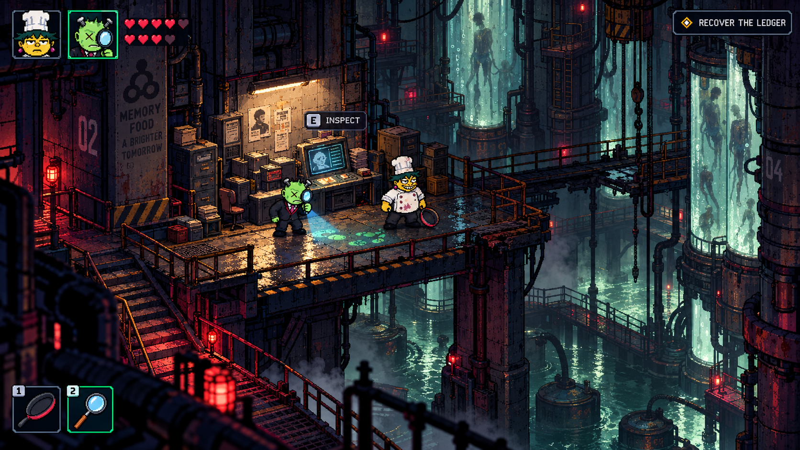
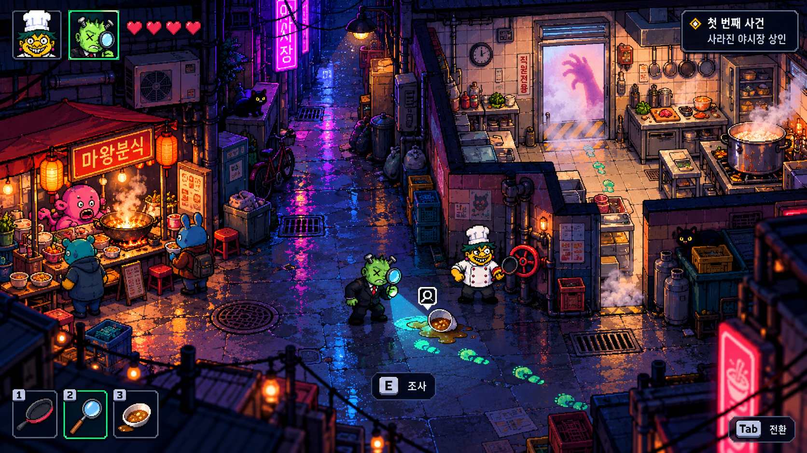
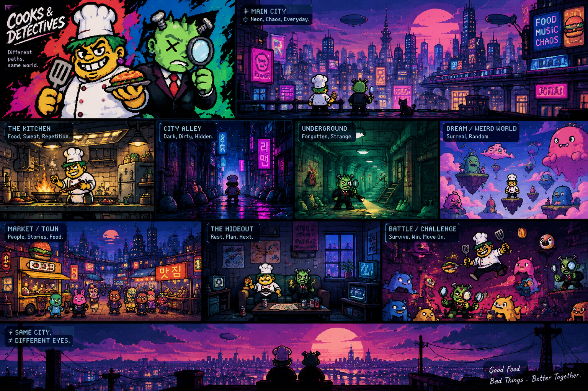
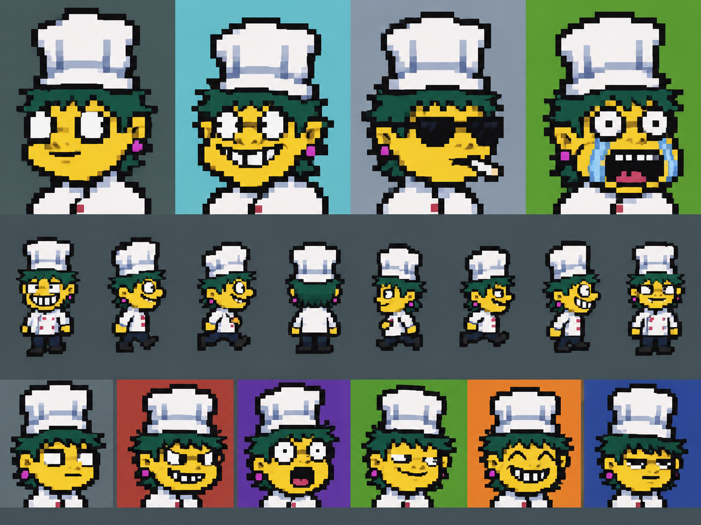
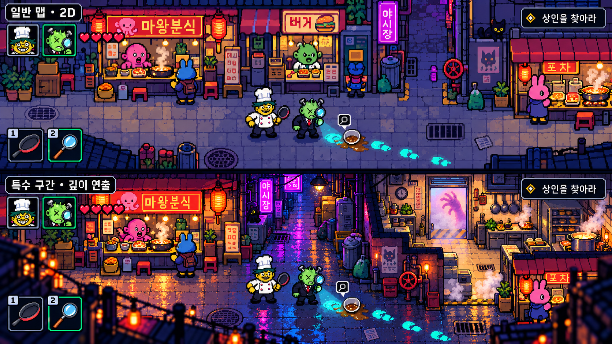
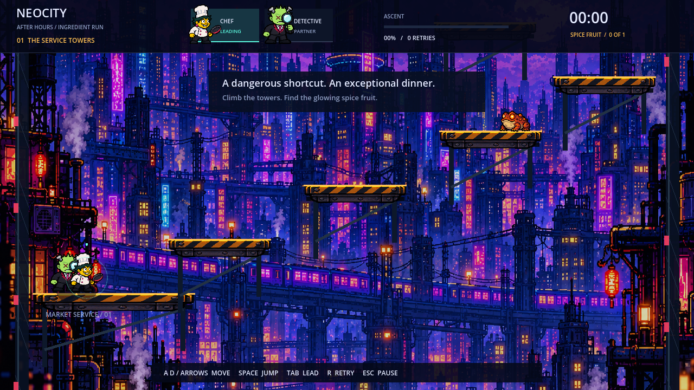

# Art direction

The selected first-release visual direction, source images, and interpretation of neocity's art references.

## Current direction

The art designer selected the first-release concept on 2026-10-27: a small single-player 2D jump-map adventure in neocity. The [creative decision record on issue #1](https://github.com/garamsh/neocity/issues/1#issuecomment-6437503751) records the requested update to [PR #5](https://github.com/garamsh/neocity/pull/5). This document was reconciled with the Godot bootstrap at commit `815f50d3d4aca35e3da3f328bc718684c8e51cba`. Art selection approves only the interpreted visual elements; it does not approve an exact collision layout or establish runtime behavior.

| Topic | Selected direction | Still open |
|---|---|---|
| First release | A compact jump-map game about the two protagonists obtaining exceptional ingredients | Final stage count, order, length, difficulty, and controls |
| Character motivation | The chef wants the best ingredients; the detective is a gourmet who wants the chef's finest dish | Dialogue, detailed relationship, character names, and ending script |
| Gameplay presentation | Side-on 2D platforming with unmistakable landing surfaces and a strong sense of urban depth | Exact camera, projection, jump physics, hitboxes, collision, and screen dimensions |
| Visual identity | Existing neon-city pixel-art aesthetic, yellow chef and green detective, dark urban atmosphere | Final pixel grid, animation inventory, asset sizes, and expression sheets |
| Map variety | Urban jump courses using roofs/signs, exhaust infrastructure, transit structures, and an elevated greenhouse | Whether all studies ship, their ingredient names, route geometry, and hazard values |
| Monster section | Include a map where creatures obstruct the protagonists' ascent; ART-JUMP-002 supplies its visual target | Exact roster, damage/knockback, response options, patrol routes, and timing |
| Screen behavior | Dynamic framing while preserving jump readability and spatial continuity | Transition triggers, duration, tracking, zoom, and layer motion |
| Story scale | A simple ingredient expedition for this release; reserve the large human-invasion/dystopian story for a future larger game | Canon of the larger story and the exact post-credits hint |

ART-JUMP-001 and ART-JUMP-002 are approved concept targets for the selected elements recorded below. They are generated visual mockups, not playable scenes or finished assets. The former top-down/oblique exploration mockups remain references for the wider city, material, and light vocabulary; they no longer define the first game's traversal camera or location scope.

The board's Battle / Challenge panel remains an entrance-art candidate, and its bottom Same city panorama an ending-credits background candidate. These are separate artwork roles, not gameplay-camera requirements. A later redraw can align them with the smaller ingredient-expedition premise.

## First-release visual brief

This section frames the art through the selected small-game premise; it is not a complete gameplay or story specification.

- The chef seeks outstanding ingredients, and the gourmet detective wants to eat the resulting dish. Both should remain recognizable participants in the climb; a still showing them in different places does not select switching, simultaneous control, follower AI, or a two-player mode.
- Show a risky, peculiar city expedition through physical roofs, signs, ducts, bridges, and greenhouse service beams. Dark scenery can coexist with a chef excited about an ingredient; the expression treatment need not imply the earlier grim investigation plot.
- Give a course a visible ingredient destination, readable ledges, and clear distinctions between solid platforms and distant decorative structures. Physical props should explain why each platform belongs there.
- Suggested obstacle progression: fixed ledges, periodic steam, moving service platforms, combined timing, then an enemy-obstructed section. These are map studies, not an implementation order or mandatory five-stage campaign.
- Creature encounters should visually emphasize reading movement and finding a gap while ascending. Avoid making ordinary progress look like a combat arena or a required boss fight; whether the player can attack or repel a creature is still undecided.
- A candidate finish returns to the restaurant and the completed dish, with a short post-credits mystery suggesting another game. The earlier proposed delivery box, the name 'Lee Jun-young', dialogue, and other specific teaser details are not accepted script or image text.
- Keep explicit human enemies, incubation laboratories, and the large dystopian reveal out of the first game's foreground premise. The earlier underground reference does not require that content to appear in this release.

## Character treatment

| Character | Preserve in visual studies | Develop or validate |
|---|---|---|
| Chef, ART-CHAR-001 | Yellow skin, dark green hair, tall white hat, white double-breasted coat, magenta ear accents, dark lower body, pan silhouette, exaggerated facial shapes | An intense or mischievous ingredient-seeking expression suited to the selected jump-map studies; pose and hat silhouette at gameplay scale; exact costume wear and staining |
| Detective, ART-CHAR-002 | Green skin, angular head silhouette, two metal bolts, X-shaped eye mark, large magnifying glass, dark suit, red/magenta accents | A focused gourmet-adventurer expression, readable glass and eye mark, separation from cool dark scenery; exact species and meaning of visible marks remain narrative decisions |

- Keep both characters recognizable in the same scene and under changing light. Their yellow/green identities and pan/glass silhouettes should survive a reduced-size review.
- Treat character sheets as concept sheets, not production-ready animation atlases. Pose rows do not establish frame counts, timing, direction coverage, or an animation pipeline.
- Keep line weight, pixel treatment, and apparent character scale coherent within a scene. Final pixel density and sprite proportions require an explicit visual test.
- Test the chef's white costume against bright lamps and the detective's black suit against dark machinery; distinguish them through local values, edge light, and background placement.

## Camera and transitions

The first-release target is a side-on 2D jump course with depth in its illustration. Landable surfaces belong to one readable movement plane. Slightly visible platform tops and thick undersides can add volume without asking players to judge movement toward or away from the screen.

| Layer or screen | Visual treatment | Readability condition |
|---|---|---|
| Playable ledges | Continuous solid tops, material thickness, selective edge light | Differentiate landing surfaces from decorative beams; test final gaps against the actual jump |
| Immediate foreground | Dark framing pipes, building edges, and supports | Do not hide the character or a critical landing during a jump |
| Recessed buildings | Windows, pipes, signage, and intermediate infrastructure | Lower contrast than the current route; do not imply a second traversable depth axis |
| Distant city | Hazy towers, rail lines, and lights | Convey height and city scale without competing with enemy telegraphs |
| Entrance candidate | ART-BOARD-001 Battle / Challenge panel | Separate illustration; action poses do not define combat or jump mechanics |
| Credits candidate | ART-BOARD-001 bottom Same city panorama | Reserve legible space for credits; exact layout and motion remain open |

Candidate motion studies:

- Track an ascent while retaining enough view of the next landing and the obstacle that affects it.
- After a safe arrival, widen or reframe to reveal the city or the next course. Avoid an unexpected framing change during a committed jump.
- Explore separate foreground/background motion for depth while keeping collision surfaces visually stable. This does not select a rendering technique or graphics backend.

Exact tracking, zoom, transitions, stage boundaries, and ordinary/special presentation ratios remain undecided. Still-image approval cannot verify camera motion, jump reachability, collisions, parallax, or performance. The custom engine and visual systems are implemented in C++; see the [runtime responsibility document](../architecture/godot-runtime.md) for the selected host and open integration details.

## Environment and light

| Element | Reference reading | Proposed use |
|---|---|---|
| Dark base | Indigo, charcoal, desaturated teal, deep violet | Establish silhouettes and atmosphere without obscuring the playable ground |
| Local accents | Cyan glass/forensic light, magenta signage, red warning lamps, amber work lights | Direct attention and distinguish places; avoid giving every surface equal brightness |
| Materials | Wet paving, rusted metal, stained tile, worn concrete, old equipment | Suggest age, density, and neglect through surface variation and selective highlights |
| Depth cues | Thick platforms, visible wall faces, foreground occlusion, stairs, distant architecture | Make vertical distance and overlapping spaces legible in a 2D composition |
| Atmosphere | Vapor, shadow, reflected colored light, distant haze | Emphasize selected layers while keeping active characters and interactions clear |
| Unease | Height, exposed infrastructure, cramped service passages, and strange urban pests | Keep the city dangerous without foregrounding the deferred human-invasion plot |

The city board includes brighter and more playful panels. Those broaden the vocabulary; the selected jump maps keep the dark urban atmosphere while allowing food-seeking character energy. Labels such as Dream / Weird world, Kitchen, and Hideout do not commit the project to those locations, mechanics, or narrative functions.

## Reference gallery

Original files are copied byte-for-byte with stable repository names. Version `v1` means the first imported source version, not a production revision. Provenance identifies what is known; supplying an image does not establish its creator, rights, model, or production readiness.

### ART-JUMP-001: Four urban jump-course studies

| Field | Record |
|---|---|
| Status | Approved target for the interpreted concept elements; v1; not production-ready or playable |
| Intent | Establish the first game's layered side-on platforming aesthetic and map variety |
| Adopted elements | Recognizable chef and detective, neon city backdrop, physical side-on ledges, substantial foreground/background depth, rare-ingredient destinations, distinct urban environments |
| Open questions | Exact map count/order, geometry, jump distances, stage lengths, checkpoint/retry rules, timers, UI, ingredients, character controls, and moving-platform/steam tuning; numbers and timings drawn in the image are illustrative |
| Source | Assistant-generated in this discussion with built-in ImageGen; model not reported. Inputs: ART-CHAR-002, ART-CHAR-001, ART-BOARD-001. Opaque reference-guided output; no explicit seed, dimensions, or quality parameter. The available prompt is retained in [the generation note](concept-art/gameplay/jump-map-prompts.txt) |
| Decision record | Art designer accepted the four-map direction and subsequently the monster-map extension; [issue #1 decision](https://github.com/garamsh/neocity/issues/1#issuecomment-6437503751), reflected on PR #5 |

| Panel | Map study | Distinct obstacle idea | Ingredient study |
|---|---|---|---|
| 01, upper left | Night-market rooftops, signs, awnings, and air conditioners | Read fixed ledges and jump gaps | Luminous spice fruit |
| 02, upper right | Giant kitchen exhaust/service shaft | Cross during a steam cycle's safe interval | Smoked-salt jar |
| 03, lower left | Elevated transit maintenance structures | Board a moving service lift and judge the next gap | Mineral seasoning canister |
| 04, lower right | Rooftop greenhouse, glass arches, and plant-covered steel | Combine previously introduced jump/timing patterns | Rare luminous mushroom |

These labels describe the images and proposed uses; they do not establish ingredient lore, exact hazard behavior, or a release commitment to four maps.

### ART-JUMP-002: Monster-obstructed ascent

| Field | Record |
|---|---|
| Status | Approved target for the interpreted concept elements; v1; not production-ready or playable |
| Intent | Add a jump map in which monsters interrupt upward progress while maintaining the selected city aesthetic |
| Adopted elements | Layered high-altitude maintenance tower, visible ingredient at the destination, both protagonists, clearly separated landings, creatures on ledges/in jump corridors, safe waiting areas, visually distinguishable obstacle zones |
| Open questions | Exact enemy species/count, patrol and flight paths, projectile speed, hitboxes, damage/knockback, player attack options, checkpoint placement, timer, and collision-valid route; the single still does not prove that every drawn gap is reachable |
| Source | Assistant-generated in this discussion with built-in ImageGen; model not reported. Inputs: ART-CHAR-002, ART-CHAR-001, ART-JUMP-001. Opaque reference-guided output; no explicit seed, dimensions, or quality parameter. Available prompt retained in [the generation note](concept-art/gameplay/jump-map-prompts.txt) |
| Decision record | Art designer explicitly selected this concept and requested the document update; [issue #1 decision](https://github.com/garamsh/neocity/issues/1#issuecomment-6437503751), reflected on PR #5 |

Creature behavior studies:

- **Ledge patrol:** squat orange toad-like pests move along a platform. Leave visible room for safe arrival and a way past them.
- **Air crossing:** purple bat/moth-like pests pass through a jump corridor, creating a timing window. Avoid hiding them against the skyline.
- **Telegraphed spit:** a wall/pipe creature prepares a horizontal projectile. Show its preparation and leave a place to wait safely.
- Separate the obstacle zones so the player can read the next problem before committing. Exact combinations and difficulty need playtesting; the concept is not a collision blueprint.

### ART-CHAR-001: Chef design

| Field | Record |
|---|---|
| Status | Reference; v1; identity baseline used by the approved jump-map concepts |
| Intent | Establish the chef's identity, palette relationships, silhouette, props, and range of facial shapes |
| Adopted elements | Requested character baseline: yellow skin, green hair, white hat/coat, magenta accents, pan; final production target pending |
| Open questions | Final dark expression set, proportions, costume condition, playable directions, and animation frames; sheet smiles are not the default mood requirement |
| Source | Art designer supplied `레트로 픽셀 셰프 캐릭터 시트.png`; original creator and generation/editing history not supplied |
| Decision record | Retained as the chef identity baseline in the [selected jump-map direction](https://github.com/garamsh/neocity/issues/1#issuecomment-6437503751); final production sheet remains open |

### ART-CHAR-002: Detective design

| Field | Record |
|---|---|
| Status | Reference; v1; identity baseline used by the approved jump-map concepts |
| Intent | Establish the detective's silhouette, face marks, costume, glass, and expression vocabulary |
| Adopted elements | Requested character baseline: green skin, bolts, X eye mark, oversized glass, dark suit and red/magenta accents; final production target pending |
| Open questions | Final dark expression set, head proportions, eye/glass treatment, directions, and animation; origin and anatomy are not established |
| Source | Art designer supplied `픽셀 아트 외계인 탐정 캐릭터 시트.png`; original creator and generation/editing history not supplied |
| Decision record | Retained as the detective identity baseline in the [selected jump-map direction](https://github.com/garamsh/neocity/issues/1#issuecomment-6437503751); final production sheet remains open |

### ART-MAP-001: Wider-world underground reference

| Field | Record |
|---|---|
| Status | Reference; v1; wider-world exploration mockup, not the first-release camera target |
| Intent | Demonstrate the requested darker tone and pronounced depth in a 2D gameplay composition |
| Adopted elements | Industrial layering, surface wear, localized light, and depth vocabulary only; this first release does not adopt the oblique traversal, incubation setting, or embedded plot |
| Open questions | Exact map, tank contents, names, plot, blood-like marks, HUD, health system, item slots, quest text, and input prompts; warm work light is an accent rather than a tone requirement |
| Source | Art designer supplied `ChatGPT 이미지 2026년 10월 27일 오후 03_20_48.png`, identified in this discussion as the earlier assistant-generated underground concept; built-in ImageGen, model not reported, opaque reference-guided output. Available generation prompt is preserved in [the source note](concept-art/gameplay/underground-refinery-prompt.txt). No fixed size, seed, or quality setting was exposed in that call |
| Decision record | Included in the designer's selected art set on 2026-10-27; embedded memory-food premise and ledger objective remain unapproved assistant suggestions |

### ART-MAP-002: Wider-world market reference

| Field | Record |
|---|---|
| Status | Reference; v1; wider-world exploration mockup, not the first-release camera target |
| Intent | Demonstrate layered urban composition, environmental density, localized light, and character readability |
| Adopted elements | Neon over a dark base, wet reflections, overlapping architecture, and material/lighting vocabulary; oblique ground movement and investigation UI are not first-release targets |
| Open questions | Actual map, NPC species, readable sign text, quests, UI layout, hearts, selected portraits, footprints, E/Tab controls, food/evidence systems, and the chef's cheerful expression |
| Source | Art designer supplied `eb9c1f90-f5ed-448c-bbfc-99858a15d19a.png`; previously presented as a generated gameplay reference, but generator, model, original prompt, and settings are not available in the supplied source |
| Decision record | Included in the designer's selected art set on 2026-10-27; this is a gameplay-composition reference, not the entrance-screen panel |

### ART-BOARD-001: City and screen candidates

| Field | Record |
|---|---|
| Status | Candidate; v1; multi-panel concept board |
| Intent | Collect location moods and distinguish gameplay scenes from entrance and credits artwork candidates |
| Adopted elements | Requested aesthetic reference: neon city layers, strong protagonist silhouettes, atmospheric interiors; designer specifically nominated the Battle / Challenge panel for entrance imagery and the bottom Same city panorama for an ending-credits background |
| Open questions | Final crops, redrawing, typography, motion, narrative meaning, actual locations, and entrance-screen context; board text and working title are not approved copy |
| Source | Art designer supplied `네온 도시의 요리사와 탐정들.png`; creator, generator, model, original prompt, and settings not supplied |
| Decision record | Art designer clarified the panel mapping in this discussion on 2026-10-27; the screen-role candidates are retained under the [first-release decision](https://github.com/garamsh/neocity/issues/1#issuecomment-6437503751), with final artwork still open |

Panel interpretation:

- **Entrance candidate:** the Battle / Challenge panel at the right of the row immediately above the bottom panorama. It shows the chef lunging diagonally and the detective among hostile shapes. Use its composition and tension as entrance-art evidence; do not interpret the drawn combat as an accepted gameplay system.
- **Ending-credits candidate:** the full-width bottom strip marked Same city, different eyes, showing both protagonists from behind against a pink/violet skyline. The intended use is a background while credits roll. It does not establish the story ending or a warm reconciliation. The credits layout still needs a legibility test over the skyline.
- **Other panels:** environment and palette studies. No panel assigns a mandatory scene, camera mode, enemy roster, or gameplay activity.

### ART-STUDY-001: Earlier sprite exploration

| Field | Record |
|---|---|
| Status | Reference; v1; supporting earlier material, not an additional selected target |
| Intent | Reconcile the earlier chef sprite-sheet source requested by issue #1 and compare character readability |
| Adopted elements | None beyond the chef identity described under Character treatment |
| Open questions | Whether any pose or proportion is useful; cheerful expressions and apparent frame ordering are not adopted |
| Source | Supplied earlier in this discussion as `복고풍 픽셀 셰프 스프라이트 시트2.png`; creator, tool, model, prompt, and settings not supplied |
| Decision record | Included for source completeness under issue #1; supporting material from the earlier discussion, not a first-release camera or sprite target |

### ART-STUDY-002: Earlier depth comparison

| Field | Record |
|---|---|
| Status | Reference; v1; supporting earlier material, not an approved mode specification |
| Intent | Reconcile the ordinary/special comparison requested by issue #1 and support a visible depth comparison |
| Adopted elements | None as a separate gameplay mode; use to compare depth and framing treatments under Camera and transitions |
| Open questions | Whether such modes exist, their frequency, how the camera moves between them, exact perspective, and runtime technique |
| Source | Supplied earlier in this discussion as `a8f4466a-6522-4a96-889a-b8dfb480f12b.png`; previously described as a generated comparison, but generator, model, prompt, and settings not available |
| Decision record | Included for source completeness under issue #1; supporting material from the earlier discussion, not a first-release camera or sprite target |

## Pending decisions

- The selected concept is not a complete game specification. Define the two-character control scheme, jump model, collision rules, recovery/checkpoints, progression, creature interactions, and difficulty in a scoped gameplay task before implementation.
- Validate the actual route at the selected resolution and jump physics. Generated ledges, gaps, and monster placements can require substantial redesign for a fair, playable course.
- Specify camera tracking and dynamic transitions through motion studies. Preserve clear landing information during ascent; do not infer unrestricted camera rotation or 3D traversal.
- Finalize entrance illustration and credits composition separately from gameplay. The older board panels are candidates, not finished full-screen assets. The exact post-credits image and text remain undecided.
- Confirm attribution where source history is unavailable. Retain original files and distinguish reference art from production resources.
- Five originally selected images, two earlier supporting studies, and the two selected jump-map mockups are imported. The generic earlier illustrations/background inventory in issue #1 is not claimed complete.
- The large human-invasion story, actual human character names, memory-food premise, laboratory revelation, and earlier proposed combat systems are not first-release requirements. No detailed future-game canon is approved by this art update.
- The playable slice now has a pure C++ engine and a separate C++/Godot adapter; see the architecture documents for the selected binding and open production-backend decisions. Concept approval does not automatically approve the generated runtime assets.

## Using this material

Use the repository's [propose-art skill](../../.agents/skills/propose-art/SKILL.md) and [collaboration procedure](../collaboration.md) for the proposal-to-task handoff. This document is the single art-direction entry point; do not create a parallel art-direction document.

- Cite an image identifier, repository-relative path, and specific interpreted elements in a later task. Example: ART-JUMP-002, `docs/art/concept-art/gameplay/infested-transit-tower-v1.png`, side-on ledges and separated monster-obstacle zones only.
- Read the relevant image and its metadata before implementation. Inclusion in the gallery does not approve every visible element.
- Keep design evidence here. Put eventual game-loaded assets with the implementation that owns them and link them to the reference; these images are not production sprite atlases or scene files.
- Update the requested direction and the relevant metadata together when a creative decision is accepted. Link the actual issue/PR decision and retain the distinction between source references, candidates, and approved targets.
- The initial concept gallery is still-image evidence. The runtime capture below records a real prototype frame; neither source establishes final animation quality, full-route balance, or production performance.

### Playable slice reference

The implementation uses [the city texture](../../project/levels/ascent/neon_city.png) and [the sprite atlas](../../project/levels/ascent/ascent_atlas.png), owned by the ascent level in the Godot project. [Generation provenance](production/ascent-asset-provenance.txt) records their prompts, references, settings, and atlas-layout limitation. The [gameplay](../architecture/gameplay.md) and [presentation](../architecture/presentation.md) responsibility documents record the rules/presentation split and prototype controls.

| Field | Record |
|---|---|
| Status | Reference; runtime art is awaiting designer acceptance |
| Intent | Translate ART-JUMP-001/002 into one playable course with independently rendered actors and platforms |
| Adopted elements | Existing approved concept palette, city depth, protagonist identity, ingredient goal, and obstacle emphasis |
| Open questions | Final animation, character interaction, balance, camera polish, background-versus-platform readability, audio, and final HUD |
| Source | Built-in ImageGen assets plus the presentation adapter's drawing; exact prompts linked above; runtime capture taken from the earlier Rust build, whose drawing the C++ adapter reproduces |
| Decision record | Implementation requested in issue #7; this does not promote newly generated assets to approved production targets |
