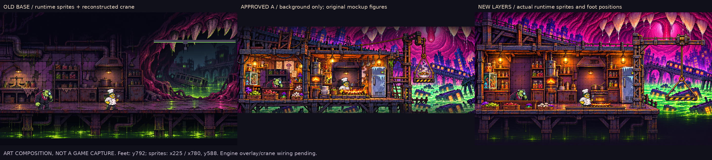

Source provenance, export ownership and review evidence for the layered base redraw in #268.

# Shelter under the teeth

- Status: implementation of the background composition selected in [the sauce decision](https://github.com/garamsh/neocity/issues/268#issuecomment-7064487457); new production pixels await the PM's bundle review.
- Adopted elements: A's left workshop, overhead teeth, magenta throat and flooded city beside the platform. The mockup's UI was rejected. Its compositing seams and figures are not production sources.
- Style and crane form: [base-kitchen-v1.png](../../concept-art/ruined-street/base-kitchen-v1.png), detailed modern pixel art, local amber workshop light, vertical hoist, long cable and triangular cradle.
- Baseline: `2ebcc10375ef1e730df6693865ce6a63fad2d743`. Only production art, its manifest and this evidence set change; runtime wiring remains an engine handoff.

## Sources and exports

| Source | Provenance | Output |
|---|---|---|
| `approved-a.png` | Byte-for-byte copy of the PM-supplied `/home/sauce/.cache/mockups-268e/base/a-shelter-under-teeth.png`; upstream creator/tool metadata not supplied | Composition reference only; top plates and bottom panels excluded from the comparison board |
| `background-source.png` | Built-in ImageGen, 1672×941 RGB | `base/kitchen.png`, 1920×1080; nearest export to 1920×1104, bottom 24 pixels removed to meet the runtime floor without a padding seam |
| `front-source.png` | Built-in ImageGen, 1672×941 RGBA | `base/kitchen_front.png`, transparent 1920×1080; upper objects mapped to y712–791 and fascia to y792–881 |
| `crane-source.png` | Built-in ImageGen, 1254×1254 RGBA | `base/feed_crane.png`, fixed 660×642; `base/feed_crane_cable.png`, 40×230; `base/feed_crane_cradle.png`, 280×220 |

- Three built-in image-generation calls on 2026-11-22; [exact prompts and reference roles](prompts.json). Model, seed and quality were not exposed. No paid credits or external image uploads were used.
- Source outputs are retained unmodified. Transparent exports use the existing crane pipeline's 50% binary-alpha convention to remove nearly invisible generated alpha outside the silhouettes. Resampling uses nearest neighbours; no palette reduction or smoothing.
- Reproduce exports and boards with `python3 docs/art/production/base-shelter-268/export.py` (Pillow required). The script updates only its five runtime files and their manifest records. Each record carries source and output SHA256 digests.
- Ownership limitation: `tools/art/toxic_night.py` still unconditionally exports the former #262 crane. Before that exporter is next used, an engine/tooling follow-up must remove its `base/feed_crane.png` export tuple or honor the manifest's new source owner. The earlier `toxic-night-screens/export.py` likewise belongs to the preceding base source and must not be run to regenerate this redraw.

## Evidence and placement

- [Full-size composite](composite.png): background, unchanged runtime idle sprites, workbench front, fixed crane, cable, cradle. This is an offline art composition, not a game capture; no display was opened.
- Character placement is checked against `src/hud/survival.cpp` at the baseline: appraiser sprite origin `(225,588)`, chef origin `(780,588)`, unchanged 256×224 sprites, foot pivot `(128,204)`, therefore feet at y792. No character pixels are baked into the background or foreground.
- The background keeps standing bays behind those positions. The foreground covers lower legs and feet. The lower structural shadows leave the UI deck's main area quiet; the existing deck and the selected new UI are not reconstructed on the new composition.
- The old panel reconstructs the resting rectangle crane and uses the same runtime sprites. The A panel shows only the supplied mockup's background band, including its original mockup figures. Neither panel claims to be a fresh runtime capture.

| Layer | Canvas position at rest | Runtime responsibility |
|---|---|---|
| `kitchen.png` | `(0,0)` | Existing background replacement |
| Existing actor sprites | Appraiser `(225,588)`; chef `(780,588)` | Preserve current scale and foot pivot |
| `kitchen_front.png` | `(0,0)` | Draw after both actors, before UI |
| `feed_crane.png` | `(1240,150)` | Fixed mast and hoist; never translate during feeding |
| `feed_crane_cable.png` | `(1650,275)` | Top remains at y275; extend its 230-pixel height by the cradle displacement |
| `feed_crane_cradle.png` | `(1530,505)` | Translate by `(0,140 × 1.5 × lowering)`; no horizontal motion |

- Coordinates and image sizes in this table are 1920×1080 canvas pixels. The HUD currently uses 1280×720 layout units; divide coordinates and dimensions by `ART_SCALE` (1.5) exactly once through its existing HD-image path.
- Keep the existing feeding reaction and lowering timing. Draw the stored dish, using the existing item renderer and existing readiness condition, centered at canvas x1666 with its bottom resting at y685 plus the cradle displacement. The cradle is empty in the assets; no duplicate food is painted into it.
- Engine follow-up: register/load the three new images, draw the front overlay after actors, replace the rectangle crane with the fixed/cable/cradle layers, extend the cable and translate only the cradle/food, and update the crane bounds metadata. Keep the UI above all scene layers. These are handoff requirements, not implemented behavior in this PR.
- Not verified here: complete in-game composition, selected UI overlap, food placement while lowering and visual acceptance. The PM owns these checks at the bundle end.
